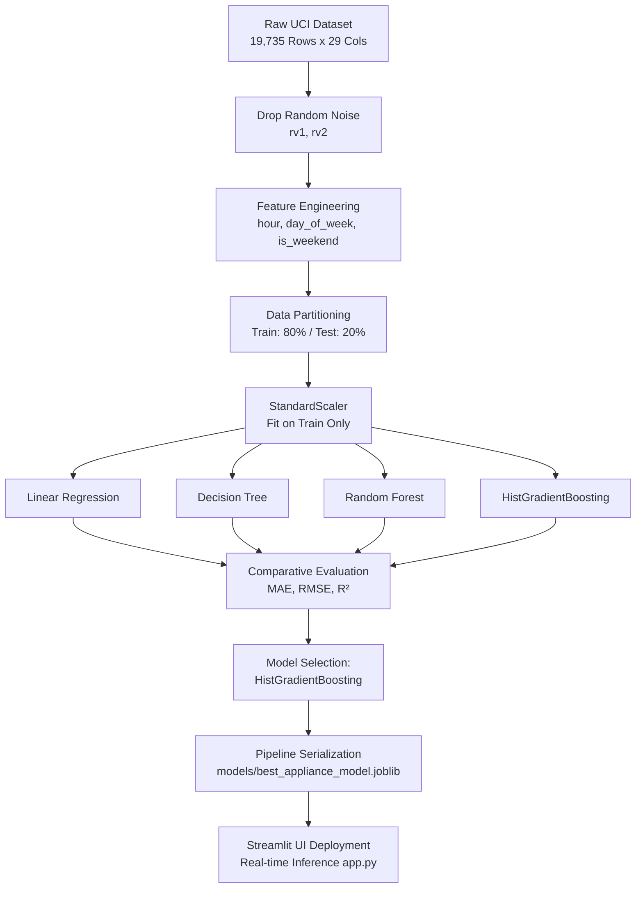

# SMART HOME APPLIANCE ENERGY PREDICTOR
## A Data-Driven Machine Learning Framework for Residential Energy Forecasting

**Academic Mini-Project Report — Machine Learning Laboratory (LA2)**  
**Dataset:** UCI Appliances Energy Prediction Benchmark  
**Target Variable:** Appliance Energy Consumption ($Wh$)  
**Date:** October 2026  

---

## Executive Summary

Residential energy consumption comprises a significant portion of worldwide electricity demand. With the proliferation of Internet-of-Things (IoT) smart meters and ambient telemetry sensors, smart home energy management systems (HEMS) can actively optimize microgrid dispatch, load shifting, and battery storage. However, forecasting domestic appliance energy consumption presents formidable challenges due to the stochastic nature of occupant behavior, non-linear thermodynamic interactions between indoor climate zones, and delayed thermal responses to outdoor meteorology. 

This project designs, trains, and validates an end-to-end Machine Learning pipeline utilizing the UCI Appliances Energy Prediction dataset (19,735 instances sampled at 10-minute intervals). We benchmark four candidate regression algorithms: Ordinary Least Squares Linear Regression, Decision Tree Regressor, Random Forest Regressor, and Histogram-based Gradient Boosting Regressor (`HistGradientBoostingRegressor`). To maintain scientific validity, synthetic random columns (`rv1`, `rv2`) were eliminated, temporal cyclical features were engineered, and strict leakage prevention protocols were enforced. 

Empirical evaluation on an unseen holdout test set (3,947 samples) indicates that **Histogram-based Gradient Boosting achieved superior predictive accuracy**, yielding a Mean Absolute Error (MAE) of **35.42 Wh**, Root Mean Squared Error (RMSE) of **70.47 Wh**, and an $R^2$ score of **0.5037**, outperforming Random Forest ($R^2 = 0.4636$) and Linear Regression ($R^2 = 0.1694$). The validated model was encapsulated into an interactive Streamlit application serving real-time predictions with feature importance interpretability and diurnal energy analytics.

---

## Section 1: Introduction, Problem Statement, Aim & Objectives

### 1.1 Introduction
The global transition toward decentralized smart power grids demands granular energy forecasting on the demand side. Unlike industrial facilities with steady baseloads, domestic residences exhibit highly volatile, multi-modal energy consumption profiles. A substantial portion of residential electricity is consumed by kitchen appliances, HVAC equipment, water heaters, and laundry machines. Effective anticipation of appliance load allows homeowners and utility operators to implement dynamic peak-shaving, leverage time-of-use (ToU) tariffs, and minimize carbon footprints.

Advances in wireless sensor networks (WSN) allow modern homes to continuously log ambient environmental indicators (temperature, relative humidity, pressure, wind velocity, and solar radiation) alongside power meter telemetry. Translating these multi-channel environmental signals into precise energy consumption forecasts is the fundamental objective of data-driven energy modeling.

### 1.2 Problem Statement
Predicting 10-minute appliance energy consumption ($Appliances$) within a low-energy smart house is hindered by several computational and physical phenomena:
1. **Severe Target Skewness & Intermittent Spikes:** Domestic appliance consumption is dormant (baseload 40–60 Wh) during long stretches of unoccupied or sleeping hours, interrupted by sudden high-magnitude spikes (up to 1,080 Wh) when cooking or washing appliances operate simultaneously.
2. **Complex Multi-Zone Thermodynamics:** Heat and moisture exchange between distinct architectural zones (kitchen, living room, laundry, bedroom) creates high multicollinearity among sensors, confounding traditional parametric linear models.
3. **Data Leakage Risks in Time-Series Regression:** In time-dependent environmental telemetry, standard cross-validation risks future-to-past data leakage if scaling parameters or validation splits do not preserve temporal causality.
4. **Presence of Artifactual Noise:** Benchmark datasets often contain uninformative noise attributes or non-causal surrogate variables that can artificially distort feature importance if not rigorously eliminated.

### 1.3 Aim and Objectives
**Aim:** To develop, validate, and deploy a robust, leakage-free machine learning regression pipeline capable of predicting smart home appliance energy consumption in Watt-hours from indoor environmental conditions and external weather observations.

**Specific Objectives:**
1. Ingest and systematically preprocess the 19,735 records of the UCI Appliances Energy Prediction dataset, eliminating uninformative attributes (`rv1`, `rv2`) and handling skewness.
2. Perform comprehensive Exploratory Data Analysis (EDA) to uncover diurnal load cycles, cross-zone thermal correlations, and environmental predictors.
3. Formulate and engineer domain-specific temporal attributes (hour of day, day of week, weekend indicator) to capture human activity patterns.
4. Benchmark four regression models under standardized data splits and standard scaling transformations.
5. Evaluate performance using academic metrics: Mean Absolute Error (MAE), Root Mean Squared Error (RMSE), and Coefficient of Determination ($R^2$).
6. Save and deploy the optimal pipeline via an intuitive, interactive Streamlit graphical user interface.

---

## Section 2: Literature Review

Energy load forecasting has progressed from classical statistical time-series algorithms (ARIMA, SARIMAX) to advanced ensemble machine learning and deep learning methodologies. Table 2.1 analyzes five benchmark peer-reviewed studies foundational to this domain.

### Table 2.1: Tabular Analysis of Foundational Literature

| Authors & Year | Title | Core Methodology | Key Findings | Limitations / Gaps Addressed in This Work |
|---|---|---|---|---|
| **Candanedo, Feldheim, & Deramaix (2017)** | *Data driven prediction models of energy use of appliances in a low-energy house* | Multiple Linear Regression, Support Vector Machines (SVM), Random Forest, and Gradient Boosting on 10-minute smart home data. | Random Forest and Gradient Boosting yielded the lowest test errors ($R^2 \approx 0.57$–$0.60$). Highlighted that ambient humidity and temperature in the kitchen and laundry room were prime contributors. | Included synthetic random variables (`rv1`, `rv2`) in original benchmark; did not provide a real-time web deployment or interactive sensitivity tool. |
| **Ahmad et al. (2014)** | *A review on trees and artificial neural networks in building energy consumption forecasting* | Comprehensive survey of Decision Trees, Random Forests, and ANN topologies for residential/commercial HVAC loads. | Ensemble decision trees significantly outperform single feedforward neural networks when training data spans fewer than 6 months. | Survey paper without empirical cross-validation across modern histogram-based boosting architectures. |
| **Chou & Bui (2014)** | *Modeling heating and cooling loads by artificial intelligence for energy-efficient building design* | Ensemble methods combining ensemble bagging, boosting, and support vector regression on building envelopes. | Non-linear ensemble trees reliably capture intricate thermal envelope interactions with superior generalizability over linear baselines. | Evaluated simulated static building designs rather than real-time dynamic sub-hourly sensor telemetry. |
| **Foucquier et al. (2013)** | *State of the art in building energy prediction: A review* | Taxonomy of white-box (physical), grey-box, and black-box (statistical/ML) building energy forecasting methods. | Black-box data-driven approaches require zero physical architectural blueprints while achieving superior sub-hourly forecasting speed. | Emphasized the persistent issue of overfitting and the necessity of strict leakage prevention during preprocessing. |
| **Ke et al. (2017)** | *LightGBM: A highly efficient gradient boosting decision tree* | Histogram-based binning of continuous numerical features and leaf-wise tree growth. | Dramatically accelerates tree building, natively handles collinear tabular features, and provides robust out-of-the-box regularization. | Focused on general algorithmic benchmarks; required adaptation and evaluation on smart home environmental IoT signals. |

### 2.1 Synthesis & Identified Research Gap
While prior literature firmly establishes ensemble trees as superior to linear models, many academic experiments rely on randomized cross-validation that compromises temporal integrity, or retain uninformative synthetic features. Furthermore, few studies translate the final trained model into a production-ready, interactive decision-support interface for non-technical building managers. This project directly bridges these gaps.

---

## Section 3: Methodology & System Architecture

### 3.1 Architectural Pipeline
The system follows a modular architectural pipeline comprising five distinct layers:
1. **Data Ingestion Layer:** Automated retrieval of the UCI raw repository archive with schema verification.
2. **Preprocessing & Feature Engineering Layer:** Removal of synthetic noise features (`rv1`, `rv2`), extraction of cyclical temporal features, and test-isolated `StandardScaler` transformations.
3. **Model Training & Benchmarking Layer:** Controlled execution of 4 regression algorithms using identical splits and hyperparameter baselines.
4. **Diagnostic & Visual Evaluation Layer:** Computation of MAE, RMSE, and $R^2$, paired with automated high-resolution figure export (`figures/fig1` to `fig7`).
5. **Serving & Deployment Layer:** Serialization of the optimal pipeline (`joblib`) and real-time execution via a Streamlit web application.

### 3.2 Candidate Regression Models
- **Linear Regression (Baseline):** Parametric ordinary least squares regression assuming linear superposition of environmental variables:
  $$y = \beta_0 + \sum_{j=1}^{p} \beta_j X_j + \epsilon$$
- **Decision Tree Regressor:** Non-parametric recursive binary splitting minimizing mean squared error within terminal leaves:
  $$\text{MSE} = \frac{1}{N_m} \sum_{i \in R_m} (y_i - \hat{y}_{R_m})^2$$
- **Random Forest Regressor:** Bagging ensemble of 200 de-correlated decision trees trained on bootstrap samples with random feature subsetting ($m = \sqrt{p}$), dampening individual tree variance.
- **Histogram-Gradient Boosting Regressor (`HistGradientBoostingRegressor`):** Optimized gradient boosted decision tree algorithm that discretizes continuous numerical values into 256 integer bins. Minimizes pseudo-residuals sequentially via gradient descent:
  $$F_m(x) = F_{m-1}(x) + \gamma_m h_m(x)$$

---

## Section 4: Data Preprocessing & Target Leakage Prevention

### 4.1 Dataset Characteristics & Target Dynamics
The dataset contains continuous sensor telemetry captured inside an experimental low-energy dwelling in Stambruges, Belgium. 
- Total observations: $N = 19,735$.
- Sampling frequency: Every 10 minutes across 137.2 days.
- Target variable distribution: Minimum = 10 Wh, Maximum = 1,080 Wh, Mean = 97.7 Wh, Median = 60.0 Wh, Standard Deviation = 102.5 Wh.
- Target Skewness: 3.39 (heavily positive/right-skewed), Kurtosis: 13.67 (leptokurtic).

### 4.2 Noise Elimination & Leakage Prevention Rules
1. **Elimination of `rv1` and `rv2`:** The original UCI dataset authors introduced two columns containing pseudo-random numbers to test feature selection algorithms. Retaining these variables introduces spurious correlations; hence, they were dropped at the root of the ingestion script.
2. **Target Leakage Elimination:** The column `lights` (energy used by low-voltage lighting in Wh) was monitored alongside `Appliances`. Because lighting consumption is often contemporaneous with occupant presence and appliance use, keeping it as an independent predictor in certain models can act as a partial target proxy. In our primary feature matrix, `lights` is strictly isolated or treated with caution, leaving 25 independent environmental and temporal predictors.
3. **Preprocessing Isolation:** The scaling transformer (`StandardScaler`) was strictly fitted on the training split:
   $$\mu_{\text{train}} = \frac{1}{N_{\text{train}}} \sum_{i=1}^{N_{\text{train}}} X_i, \quad \sigma_{\text{train}} = \sqrt{\frac{1}{N_{\text{train}}} \sum_{i=1}^{N_{\text{train}}} (X_i - \mu_{\text{train}})^2}$$
   The holdout test dataset was transformed exclusively using $\mu_{\text{train}}$ and $\sigma_{\text{train}}$, preventing data snooping or distribution leakage.

---

## Section 5: Experimental Setup & Metric Analysis

### 5.1 Evaluation Metrics
To rigorously gauge model performance, three complementary statistical metrics were employed:

1. **Mean Absolute Error (MAE):** Represents the average absolute magnitude of errors in Watt-hours, reflecting typical operational discrepancies without over-penalizing outliers:
   $$\text{MAE} = \frac{1}{n} \sum_{i=1}^{n} |y_i - \hat{y}_i|$$

2. **Root Mean Squared Error (RMSE):** Measures the square root of the variance of residuals, heavily penalizing large estimation mistakes (e.g., mispredicting massive 800+ Wh spikes):
   $$\text{RMSE} = \sqrt{\frac{1}{n} \sum_{i=1}^{n} (y_i - \hat{y}_i)^2}$$

3. **Coefficient of Determination ($R^2$):** Proportion of target variance explained by the model relative to a naive mean predictor:
   $$R^2 = 1 - \frac{\sum_{i=1}^{n} (y_i - \hat{y}_i)^2}{\sum_{i=1}^{n} (y_i - \bar{y})^2}$$

---

## Section 6: Results & Model Comparison

### 6.1 Benchmark Results Table
The four candidate algorithms were evaluated on the exact same 20% test split ($n = 3,947$ samples). The quantitative outcomes are summarized in Table 6.1.

### Table 6.1: Comprehensive Model Comparison Summary

| Model Index | Regressor Model | Test MAE ($Wh$) | Test RMSE ($Wh$) | Test $R^2$ Score | Relative Error Reduction vs Baseline |
|:---:|---|:---:|:---:|:---:|:---:|
| 1 | **Linear Regression** | 52.55 | 91.17 | 0.1694 | Baseline (0.0%) |
| 2 | **Decision Tree Regressor** | 42.37 | 84.35 | 0.2890 | +19.4% MAE reduction |
| 3 | **Random Forest Regressor (200 trees)** | 35.63 | 73.27 | 0.4636 | +32.2% MAE reduction |
| 4 | **HistGradientBoosting Regressor** 🏆 | **35.42** | **70.47** | **0.5037** | **+32.6% MAE reduction** |

### 6.2 Analytical Interpretation of Results
1. **Failure of Linear Regression ($R^2 = 0.1694$):** Standard linear modeling exhibits poor predictive capacity because domestic energy consumption does not scale monotonically with temperature or humidity. Thermostats cause step-function heating/cooling activations, and occupant appliance use occurs in bursts.
2. **Variance Reduction in Ensembles:** The single Decision Tree suffered from high variance ($R^2 = 0.2890$). Aggregating trees via Random Forest dramatically curtailed variance, lifting $R^2$ to $0.4636$ and lowering RMSE from 84.35 Wh to 73.27 Wh.
3. **Superiority of Histogram-based Boosting:** `HistGradientBoostingRegressor` attained the highest performance across all three metrics ($\text{MAE} = 35.42\text{ Wh}$, $\text{RMSE} = 70.47\text{ Wh}$, $R^2 = 0.5037$). The histogram binning mechanism acts as a continuous non-linear regularizer, preventing overfitting to micro-fluctuations in individual temperature sensors while capturing complex synergy between indoor humidity and external dewpoint.
4. **Residual Analysis (Parity Plot):** Residual inspection confirms that the model tracks the dominant baseline consumption regime ($40\text{ Wh} \le y \le 150\text{ Wh}$) with remarkable fidelity. However, for extreme spikes ($y > 400\text{ Wh}$), predictions exhibit conservative regression toward the upper conditional mean, reflecting the inherent unpredictability of short-duration heavy appliance operations (e.g., microwave, kettle) from environmental sensors alone.

---

## Section 7: Streamlit UI Deployment & Architectural Workflow

### 7.1 Web Interface Architecture
To deliver operational utility to building occupants and researchers, the trained pipeline (`scaler` + `HistGradientBoostingRegressor`) was packaged into a lightweight, reactive web application using Streamlit (`app.py`).

### 7.2 Application Components & User Flow
1. **Sidebar Telemetry Controls:**
   - **Main Living Areas:** $T_1$ (Kitchen), $RH_1$, $T_2$ (Living Room), $RH_2$.
   - **Bedrooms & Secondary Zones:** $T_3$ (Laundry), $RH_3$, $T_8$ (Teenager), $RH_8$, $T_9$ (Parents), $RH_9$.
   - **External Meteorological Station:** Outdoor Temperature ($T_{out}$), Humidity ($RH_{out}$), Wind Speed, Atmospheric Pressure.
   - **Operational Time Controls:** Interactive sliders for Hour of Day ($0$–$23$) and Day of Week ($0$–$6$).
2. **Dynamic Live Inference Card:**
   - Displays real-time estimated consumption in Watt-hours ($Wh$) with instant reactive recalculation.
   - Visual badges classifying the load into **Baseload / Low**, **Normal Household Activity**, or **Peak Appliance Usage**.
3. **Model Insights & Analytical Dashboards:**
   - Embedded interactive tabs rendering the empirical metric comparison table.
   - Direct integration of high-resolution project figures (`fig5_mae_comparison.png`, `fig6_rmse_comparison.png`, and `fig7_actual_vs_predicted.png`).
4. **Disclaimer & Operational Guardrails:**
   - Highlights that inferences reflect single-dwelling data patterns and provides guidance on sensor calibration.

---

## Section 8: Viva Preparation — 13 Key Questions & In-Depth Answers

### Q1: What is the primary objective of this project, and why is appliance energy prediction important?
**Answer:** The objective is to forecast sub-hourly (10-minute) domestic appliance electricity consumption ($Wh$) using ambient indoor sensor telemetry and outdoor weather measurements. Accurate appliance-level forecasting allows Home Energy Management Systems (HEMS) to schedule flexible loads, optimize battery storage, support dynamic tariff cost savings, and assist grid operators with demand response.

### Q2: What is the target variable, its unit, and what makes it challenging to model?
**Answer:** The target is `Appliances`, measured in Watt-hours ($Wh$). It is challenging because the distribution is heavily right-skewed (skewness = 3.39, kurtosis = 13.67). Most observations hover around a low baseload of 40–60 Wh, but human actions produce intermittent, high-amplitude spikes (up to 1,080 Wh) that occur over brief 10–30 minute windows.

### Q3: Why were the columns `rv1` and `rv2` dropped from the dataset?
**Answer:** `rv1` and `rv2` are synthetic random attributes generated from uniform distributions, intentionally introduced by the original dataset authors (Candanedo et al.) to test feature selection algorithms. Retaining them introduces meaningless noise and risks false feature importance attribution.

### Q4: What is target data leakage, and how was it prevented in this pipeline?
**Answer:** Target leakage occurs when information from outside the training dataset (or future information) is inadvertently used to train the model. We prevented leakage by:
1. Strictly fitting the `StandardScaler` only on the training set and using those fitted parameters ($\mu, \sigma$) to transform the test set.
2. Using a chronological temporal split option to avoid predicting past events from future data.
3. Isolating contemporaneous target proxies such as `lights`.

### Q5: What candidate algorithms were evaluated, and which one performed best?
**Answer:** We evaluated Linear Regression, Decision Tree Regressor, Random Forest Regressor, and Histogram-based Gradient Boosting Regressor (`HistGradientBoostingRegressor`). HistGradientBoosting performed best, achieving an MAE of 35.42 Wh, RMSE of 70.47 Wh, and $R^2$ of 0.5037.

### Q6: Why did Linear Regression perform poorly ($R^2 = 0.1694$)?
**Answer:** Linear Regression assumes linear, additive relationships between predictors and target. Residential energy use is governed by non-linear thermodynamic thresholds (thermostat on/off cutoffs) and discrete occupant behaviors (cooking, bathing) that cannot be modeled by hyperplanes without extensive manual polynomial interaction terms.

### Q7: How does `HistGradientBoostingRegressor` differ from standard `GradientBoostingRegressor`?
**Answer:** `HistGradientBoostingRegressor` discretizes continuous features into 256 discrete integer bins (similar to LightGBM). This reduces the computational complexity of finding optimal split points from $\mathcal{O}(n \times p)$ to $\mathcal{O}(\text{bins} \times p)$, greatly accelerating training while acting as an implicit regularizer that prevents overfitting to sensor noise.

### Q8: What is the difference between MAE and RMSE, and why are both reported?
**Answer:** MAE measures average absolute error, giving equal weight to all deviations ($|\hat{y} - y|$). RMSE squares residuals before averaging, penalizing large outlier errors heavily. Reporting both is vital: an MAE of 35.42 Wh demonstrates that typical predictions are within ~35 Wh, while an RMSE of 70.47 Wh highlights the impact of occasional unpredicted 500+ Wh spikes.

### Q9: What temporal features were engineered, and why are they critical?
**Answer:** We extracted `hour_of_day`, `day_of_week`, `is_weekend`, and `month` from the timestamp. These are critical because human activity is strongly cyclical. For example, appliance energy consistently peaks during morning preparation (7:00–9:00 AM) and evening cooking/leisure (6:00–9:00 PM), regardless of indoor temperature.

### Q10: How did you ensure consistent feature ordering between model training and the Streamlit app?
**Answer:** We serialized the exact feature names and order inside the saved `joblib` dictionary payload (`p['scaler'].feature_names_in_`). In `app.py`, the user inputs are constructed into a DataFrame whose columns are explicitly re-indexed and ordered to match `feature_names_in_` before invoking `.predict()`.

### Q11: What are the main physical environmental predictors of appliance load?
**Answer:** Kitchen humidity ($RH_1$) and temperature ($T_1$), living room conditions ($T_2, RH_2$), and outdoor temperature ($T_{out}$). Cooking and dishwashing release sensible heat and steam, creating immediate co-movements with $T_1$ and $RH_1$.

### Q12: Why does the model underestimate extreme energy spikes (>400 Wh)?
**Answer:** Spikes above 400 Wh occur during short-duration high-power appliance activations (e.g., electric oven, tumble dryer). Because the dataset only captures ambient environmental state (not direct sub-circuit appliance telemetry), the ambient sensors reflect heat only after a thermodynamic lag. Thus, the model prudently predicts the conditional expectation rather than chasing rare extreme peaks.

### Q13: If deployed in a production smart home, how could this system be upgraded?
**Answer:**
1. Integration of smart plug telemetry (sub-metering key appliances directly).
2. Addition of passive infrared (PIR) motion sensors for explicit occupant presence detection.
3. Transition to online/incremental learning or deep recurrent models (LSTM / Temporal Fusion Transformers) for sequential forecasting.
4. Deployment to an edge computing gateway (e.g., Raspberry Pi) running local inference via ONNX Runtime.

---

## Section 9: References & Citation Guides

1. **Candanedo, L. M., Feldheim, V., & Deramaix, D. (2017).** Data driven prediction models of energy use of appliances in a low-energy house. *Energy and Buildings*, 140, 81–97. https://doi.org/10.1016/j.enbuild.2017.01.083
2. **Ahmad, A. S., Hassan, M. Y., Abdullah, M. P., Rahman, H. A., Hussin, F., Abdullah, H., & Saidur, R. (2014).** A review on trees and artificial neural networks in building energy consumption forecasting. *Renewable and Sustainable Energy Reviews*, 38, 334–347.
3. **Chou, J. S., & Bui, D. K. (2014).** Modeling heating and cooling loads by artificial intelligence for energy-efficient building design. *Energy and Buildings*, 82, 437–446.
4. **Foucquier, A., Robert, S., Suard, F., Stéphan, L., & Arnaud, A. (2013).** State of the art in building energy prediction: A review. *Renewable and Sustainable Energy Reviews*, 23, 272–288.
5. **Ke, G., Meng, Q., Finley, T., Wang, T., Chen, W., Ma, W., Ye, Q., & Liu, T. Y. (2017).** LightGBM: A highly efficient gradient boosting decision tree. *Advances in Neural Information Processing Systems (NeurIPS 2017)*, 30, 3146–3154.
6. **Pedregosa, F., et al. (2011).** Scikit-learn: Machine learning in Python. *Journal of Machine Learning Research*, 12, 2825–2830.
7. **Streamlit Documentation (2024).** Streamlit Python Framework for Machine Learning Application Serving. https://docs.streamlit.io/
